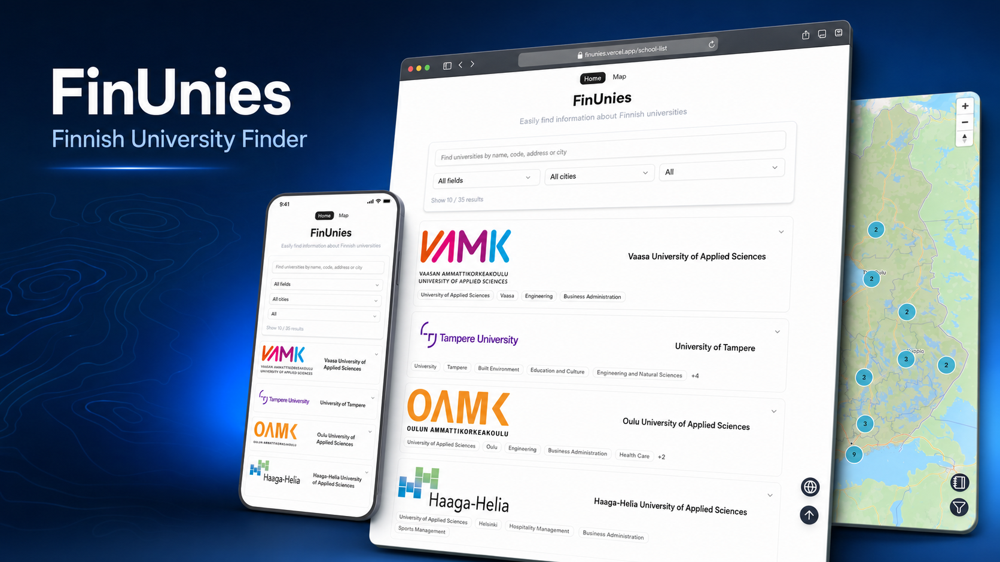

# 🇫🇮 FinUnies – Finnish School Searcher

**FinUnies** is a modern web app that helps users explore and search for universities, universities of applied sciences (UAS), and vocational schools across Finland.  
Built with **Next.js**, **Mapbox**, and **MongoDB Atlas**, it provides an intuitive and interactive experience.

---

## ✨ Key Features

- 🔍 **Search by name, city, field of study, or school type**
- 🗺️ **Mapbox-powered interactive map** with clustering and clickable markers
- 📍 **Geolocation support** – find schools near your current location
- 📚 **School details** – including tuition fees, scholarships, degree levels
- ⚡ **Fast performance** with server-side rendering (SSR) using Next.js

---

## 🛠️ Technologies Used

- **Framework**: [Next.js](https://nextjs.org/)
- **Mapping**: [Mapbox GL JS](https://docs.mapbox.com/mapbox-gl-js/)
- **Database**: [MongoDB Atlas](https://www.mongodb.com/cloud/atlas)
- **Deployment**: [Vercel](https://vercel.com/)
- **Styling**: Tailwind CSS, shadcn/ui

---

## 🌐 Live Website

👉 [https://finunies.vercel.app/school-list](https://finunies.vercel.app/school-list)

You can access the platform on desktop or mobile devices. No sign-up required.

---

## 📄 License

This project is open-source and available under the [MIT License](./LICENSE).

---

